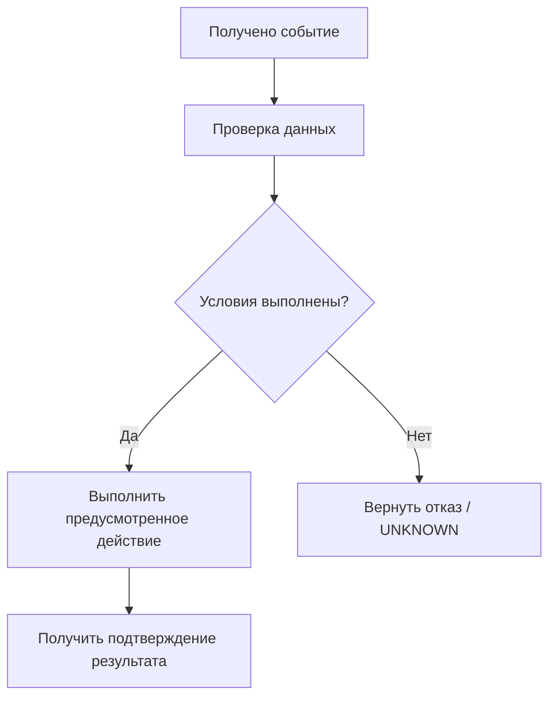

# Шаблон спецификации программного модуля

**Назначение:** единый шаблон проектирования программных компонентов DockStation.  
**Статус шаблона:** рабочий.  
**Редакция:** 0.1.

> Перед использованием скопируйте этот файл в отдельный документ модуля и заполните его. Удалять неприменимые разделы без объяснения не следует: укажите «не применимо» и причину.

---

# [Название модуля]

**Идентификатор компонента:** [если принят в реестре]  
**Версия документа:** [0.x]  
**Дата:** [ГГГГ-ММ-ДД]  
**Статус спецификации:** НЕ НАЧАТА / ЧЕРНОВИК / НА ПРОВЕРКЕ / СОГЛАСОВАНА / ЗАБЛОКИРОВАНА  
**Статус реализации:** НЕ НАЧАТО / В РАЗРАБОТКЕ / РЕАЛИЗОВАНО / НЕ РЕАЛИЗОВАНО / ЗАБЛОКИРОВАНО  
**Статус проверки:** НЕ ПРОВЕРЕНО / ПРОВЕРЕНО — ПРОЙДЕНО / ПРОВЕРЕНО — НЕ ПРОЙДЕНО / ПРОВЕРЕНО — ЧАСТИЧНО

## 1. Назначение

Кратко и однозначно описать, зачем нужен модуль и какую проблему он решает.

Указать:
- основную функцию;
- ожидаемый результат;
- место модуля в общей архитектуре;
- область применения.

Не описывать здесь детали реализации конкретной платы или библиотеки.

## 2. Источники и основания

Перечислить документы и требования, на которых основана спецификация:

| Источник | Раздел / ID | Что задаёт |
|---|---|---|
| `docs/02_REQUIREMENTS.md` | [REQ-ID] | [Требование] |
| `docs/05_SOFTWARE_ARCHITECTURE.md` | [Раздел] | [Архитектурный принцип] |
| `docs/06_INTERFACES_AND_DATA_CONTRACTS.md` | [Раздел] | [Контракт] |
| `docs/09_SAFETY_AND_FAILURES.md` | [FAIL-ID] | [Отказ / защитная реакция] |
| [Другой документ] | [Раздел] | [Основание] |

Разделять согласованные решения, исходные требования, предложения, допущения и неизвестные параметры. Не повышать статус предложения без согласования владельца проекта.

## 3. Границы ответственности

### 3.1. Модуль отвечает за

- [Функция 1]
- [Функция 2]

### 3.2. Модуль не отвечает за

- [Чужая функция 1]
- [Чужая функция 2]

### 3.3. Взаимодействующие компоненты

| Компонент | Зачем взаимодействует | Направление обмена |
|---|---|---|
| [Компонент] | [Назначение] | Вход / выход / двусторонний |

Не дублировать ответственность соседних модулей. При пересечении границ указать, какой компонент является владельцем соответствующей функции.

## 4. Модель работы

Описать алгоритм работы модуля последовательностью шагов или диаграммой.

При необходимости использовать Mermaid:

Схема должна соответствовать тексту. Отдельно показать штатные, отказные и восстановительные ветви.

## 5. Входные данные

Для каждого входа определить источник, тип и правила достоверности.

| Поле / событие | Источник | Тип / единица | Обязательность | Проверки качества и актуальности | Реакция при отсутствии |
|---|---|---|---|---|---|
| [Название] | [Компонент] | [Тип, единица] | [Да/нет] | [Правило] | [Реакция] |

Отсутствующие данные не заменять нулём или значением по умолчанию, если это меняет смысл. Для измерений указывать единицы и временную метку.

## 6. Выходные данные и события

| Выход / событие | Получатель | Содержание | Условие формирования | Подтверждение |
|---|---|---|---|---|
| [Название] | [Компонент] | [Поля] | [Условие] | [Как подтверждается] |

Разделять:
- сформированный запрос;
- принятый запрос;
- начатую операцию;
- завершённую операцию;
- подтверждённый результат;
- отказ или тайм-аут.

Отправка команды сама по себе не означает успешного выполнения.

## 7. Контракты интерфейсов

Описать каждый внешний интерфейс.

Для команды или сообщения определить, где применимо:
- уникальный идентификатор сообщения;
- тип события или команды;
- источник и получатель;
- время формирования;
- идентификатор операции;
- параметры и единицы;
- статус достоверности;
- срок актуальности;
- код ошибки и причина;
- правила повторной обработки.

Не выбирать транспорт или протокол без отдельного решения. В этой спецификации описывается смысл данных, а не привязка к UART, SPI, I2C, Modbus, MQTT, TCP или другой технологии.

## 8. Состояния и переходы модуля

Если модуль имеет собственную модель состояний, привести её отдельно от глобальных состояний станции.

| Состояние | Значение | Условия входа | Условия выхода |
|---|---|---|---|
| [Состояние] | [Описание] | [Условия] | [Условия] |

Не смешивать состояние модуля, состояние операции и состояние всей станции.

## 9. Взаимодействие с безопасностью

Указать:
- какие действия модуля могут повлиять на безопасность;
- какие разрешения SafetyManager необходимы;
- какие данные должны быть актуальны;
- что происходит при ALLOW, DENY и UNKNOWN;
- как обрабатывается истечение или отзыв разрешения;
- какие аппаратные защитные механизмы необходимы;
- как модуль реагирует на потерю связи с SafetyManager.

Модуль не должен обходить защитные блокировки. Неизвестное состояние не является разрешением.

## 10. Ошибки и отказные сценарии

| Сценарий / код ошибки | Условие обнаружения | Реакция модуля | Влияние на станцию | Восстановление |
|---|---|---|---|---|
| [Ошибка] | [Условие] | [Действие] | [Последствие] | [Условия] |

Учесть, где применимо:
- отсутствие ответа;
- устаревшие данные;
- недопустимые значения;
- повторные и запоздавшие события;
- противоречивые показания;
- тайм-аут;
- перезапуск;
- потерю питания;
- частичное выполнение операции.

Сослаться на соответствующие FAIL-ID из матрицы отказов. Не придумывать новые защитные реакции, противоречащие согласованной документации.

## 11. Время и асинхронность

Определить:
- какие операции требуют контроля длительности;
- какие события могут поступать асинхронно;
- как выявляются зависшие операции;
- как проверяется срок актуальности данных и разрешений;
- что должно произойти при потере источника времени.

Для измерения интервалов при реализации должна использоваться монотонная шкала времени. Календарное время используется для временных меток и журналирования. Спецификация не должна зависеть от конкретной функции или API времени.

Длительные операции ввода-вывода, сети, файловой системы и оборудования не должны блокировать критическую логику на неопределённое время.

## 12. Сохранение и восстановление

Указать:
- какие данные должны переживать перезапуск;
- что можно восстановить из журналов;
- что необходимо заново запросить у оборудования;
- какие незавершённые операции нельзя автоматически продолжать;
- как обнаруживается несогласованность сохранённого и фактического состояния.

Сохранённое состояние программы не является доказательством фактического состояния оборудования.

## 13. Технологическая независимость и переносимость

### 13.1. Логика модуля

Указать, какая часть поведения должна оставаться независимой от аппаратуры и среды исполнения.

### 13.2. Требуемые интерфейсы

Перечислить абстрактные интерфейсы, через которые модуль взаимодействует с внешним миром.

### 13.3. Адаптеры

Описать, какие адаптеры потребуются для конкретных реализаций. Не назначать заранее ESP32, Orange Pi, конкретную ОС или язык программирования, если это не утверждено владельцем проекта.

### 13.4. Распределённое размещение

Указать, может ли модуль работать:
- внутри одного процесса;
- в отдельном процессе;
- на отдельном контроллере или вычислительном устройстве.

Не считать эти варианты автоматически эквивалентными: при распределении нужно учитывать задержки, потерю связи, повтор сообщений, время и отказ вычислительного узла.

### 13.5. Тестовые реализации

Указать, какие зависимости можно заменить имитаторами для тестирования на обычном ПК.

## 14. Безопасность данных и доступ

Если применимо, описать:
- проверку входных данных;
- аутентификацию источника;
- авторизацию команд;
- защиту от повтора;
- обработку недоверенных имён и путей;
- защиту секретов;
- журналирование значимых действий.

Не проектировать собственные криптографические алгоритмы.

## 15. План тестирования

### 15.1. Модульные тесты

| ID теста | Сценарий | Ожидаемый результат |
|---|---|---|
| [TEST-ID] | [Входные данные и действие] | [Проверяемое поведение] |

### 15.2. Тесты с имитаторами

Указать зависимости, которые заменяются имитаторами, и сценарии отказов.

### 15.3. Интеграционные тесты

Указать, с какими компонентами проверяется совместная работа.

### 15.4. Аппаратные испытания

Указать, какие аспекты невозможно подтвердить программной имитацией и требуется проверить на реальном оборудовании.

Тест считается выполненным только при фактическом запуске с зафиксированным результатом.

## 16. Критерии готовности и приёмки

Спецификация готова к согласованию, если:
- назначение и границы однозначны;
- входы, выходы и контракты описаны;
- обработка ошибок определена;
- требования безопасности учтены;
- открытые вопросы перечислены;
- требования связаны с проверками;
- отсутствуют неподтверждённые аппаратные и технологические допущения.

Реализация готова к интеграции только после выполнения критериев из `docs/11_TESTING_AND_ACCEPTANCE.md`. Готовность к интеграции не равна готовности к эксплуатации.

## 17. Открытые вопросы и допущения

| ID | Вопрос / допущение | Почему важно | Варианты / источник | Кто и когда должен согласовать |
|---|---|---|---|---|
| [Q-ID] | [Описание] | [Последствие] | [Варианты] | [Ответственный / дата] |

Неизвестное не превращать в скрытое допущение.

## 18. Влияние на другие документы и модули

Перечислить документы, требования, интерфейсы, отказы и тесты, которые нужно обновить при согласовании этой спецификации.

## 19. История изменений

| Версия | Дата | Изменение | Основание / согласование |
|---|---|---|---|
| 0.1 | [Дата] | Первичная редакция | [Основание] |

## 20. Итоговая проверка перед передачей владельцу проекта

- [ ] Источники и статусы сведений указаны.
- [ ] Границы ответственности не пересекаются с соседними модулями.
- [ ] Интерфейсы описаны без преждевременного выбора протокола.
- [ ] Команды отделены от подтверждённых результатов.
- [ ] ALLOW / DENY / UNKNOWN обрабатываются явно.
- [ ] Отказы и восстановление описаны.
- [ ] Технологическая независимость рассмотрена.
- [ ] Есть тесты и критерии приёмки.
- [ ] Открытые вопросы не замаскированы предположениями.
- [ ] Связанные документы и реестр модулей обновлены.
